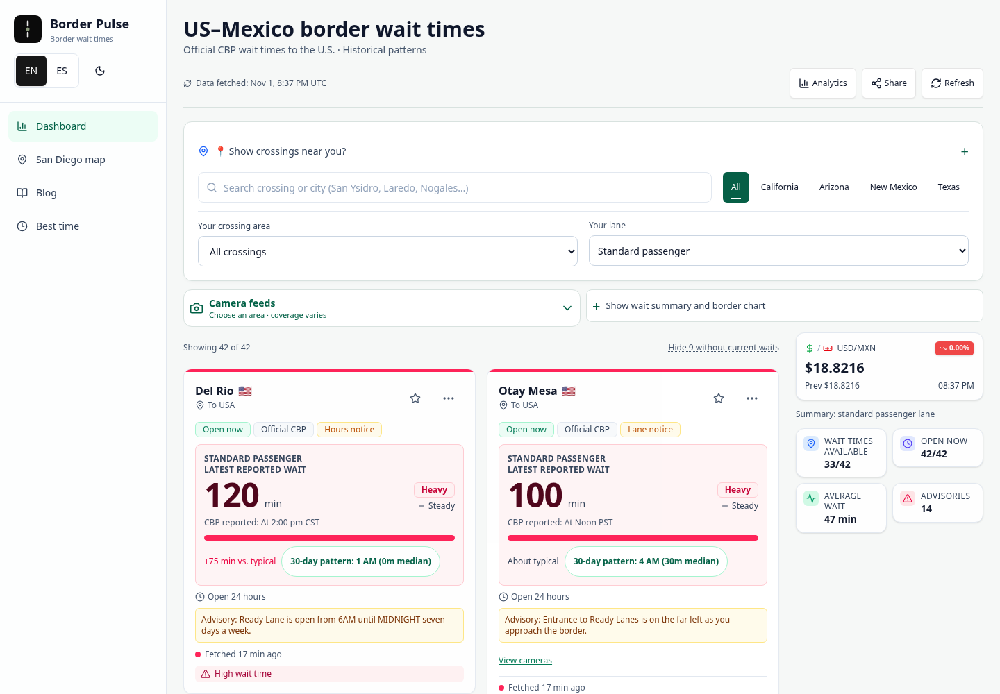
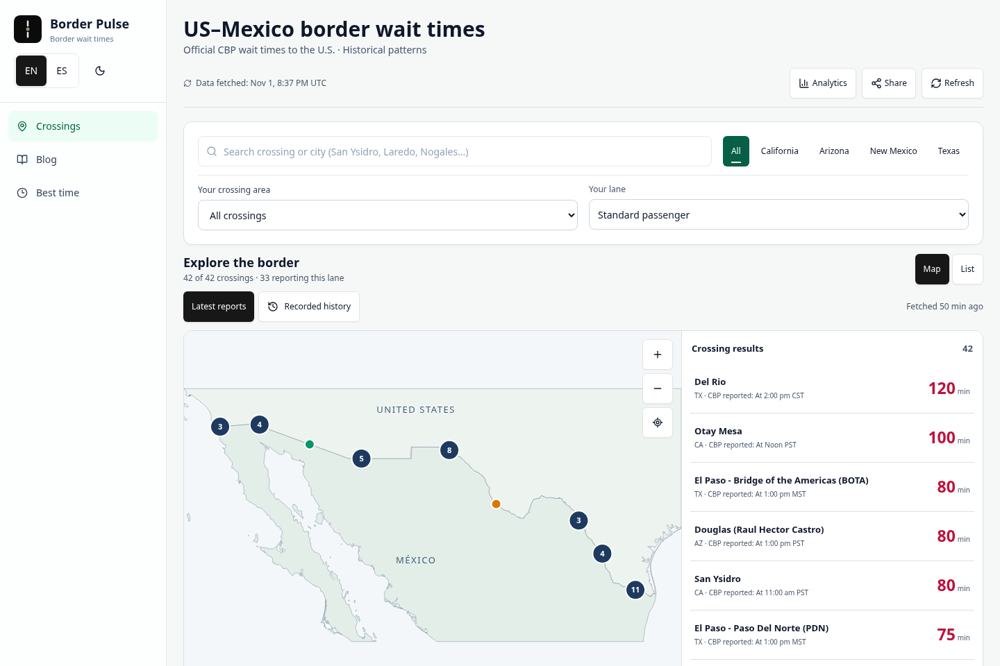
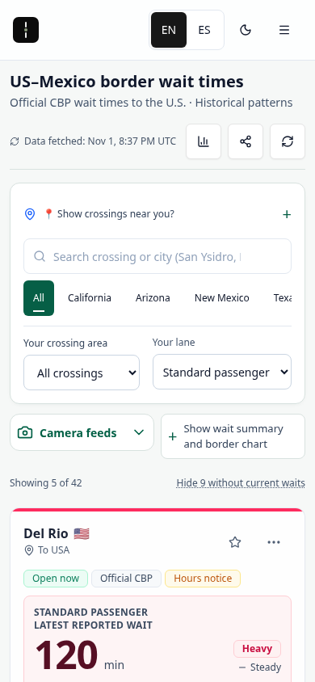
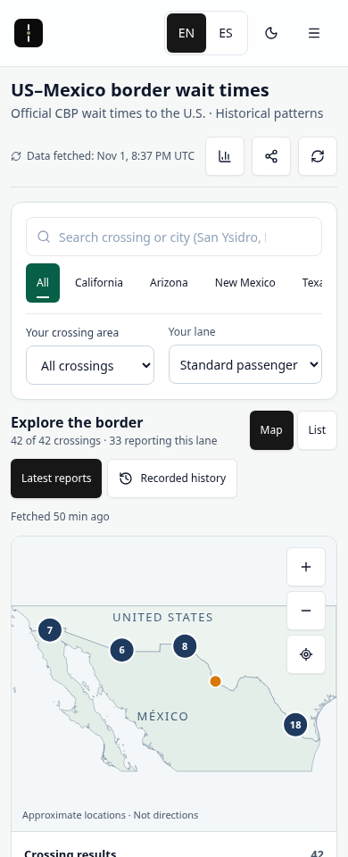

# Border-wide crossing experience — review preview

This candidate replaces the regional map identity with one geographic way to explore the existing crossing catalog. Base: `5e6cfb146b8173b8178d50c9dabf1808fd64f6be`. Production is unchanged. The separate resize-test patch remains paused and is not included.

The existing main crossing screen opens on **Map**, with **List** alongside it. Both use the existing search, state, area and lane controls. San Diego–Tijuana is one area among the other border regions. There is one **Crossings / Cruces** main-navigation entry; no extra map tab or promotional dashboard card. Existing list cards, favorites, comparisons, camera pages, analytics, share tools, news and editorial content remain available.

## Try it

- Open `/` or `/?area=all`: all 42 catalog records, covering CA, AZ, NM and TX. Prior saved regional preferences cannot silently reduce “All crossings” to three records.
- Choose a state or crossing area. The real geographic overview fits that scope and the results follow the same filter. Zoom clusters or select a result; the native report opens beside the map, or below it on a phone.
- Change lane: map colors, result values and the selected report use the existing availability rules. Report clocks are raw CBP text, separate from retrieval time. Zero is a value; missing/closed states remain unavailable.
- Use Escape/Back, Map/List, search, keyboard marker navigation, zoom controls or pointer pan/pinch. Selection and filters live in URL state. Filters are derived directly from the committed router location: CI caught an earlier mirrored-state bug where Back restored the All-crossings URL while Texas remained rendered. The correction removes that duplicated state. Action handlers also merge against the browser’s current query: CI exposed a rapid Standard-selection/replay-scrub sequence that could otherwise restore a render-captured SENTRI query. The archive range stays unavailable until observations load. The map retains its camera across Map/List switches; the full-card List explicitly returns to Latest reports. The compact map results follow the selected replay instant.
- Choose Recorded history: fetch the existing archive only on request. It contains Standard summary observations, not lane clocks/counts. An empty retrieval remains a gap; unsupported lanes require an explicit Standard choice. No current value is substituted for failed history.
- Old `/corridor/san-diego-tijuana/` bookmarks redirect to that area within the same home experience, preserving lane context. Crossing-page “All crossings” links explicitly clear regional scope. Each crossing has a subtle “View on the border map” link.

The former two-port extra-drive input is not generalized into the border overview in this candidate. Existing full comparison and walk-or-drive pages remain. This is a structural map preview, not a claim that every former regional-console affordance has been retained.

## Visual evidence

These are real local production-mode builds, not live-site captures or generated mockups. The unmodified reference and candidate use the repository's actual dated CBP snapshot, fetched **2026-11-01 20:37:32.153 UTC**. Browser requests outside localhost were blocked. The public domain was unavailable through this executor's proxy; that restriction was not bypassed. No fixture values or frozen clock were used for these review images/recording.

| Existing main screen | Integrated border map |
| --- | --- |
|  |  |
|  |  |

[Desktop map](borderwide-map-review/after-1440-en-light-map.png) · [Selected report](borderwide-map-review/after-1440-en-light-detail.png) · [Spanish phone map](borderwide-map-review/after-390-es-light-map.png) · [Spanish phone detail](borderwide-map-review/after-390-es-light-detail.png) · [Dark theme](borderwide-map-review/after-1440-es-dark-map.png) · [Actual browser motion recording](borderwide-map-review/borderwide-motion-v2.mp4) · [Capture receipt](borderwide-map-review/review-capture-receipt.json)

The camera interpolates geometry and inverse-sized markers in the same animation frame. This avoids marker/outline ballooning during zoom. Drag follows input directly; reduced motion reaches the camera endpoint without spatial interpolation. There is no moving-traffic animation or simulated queue.

## Geographic scope and limits

**Superseded by the [geographic correction review](BORDERWIDE-GEOGRAPHY-REVIEW.md).** The original 40-pin candidate below contained material inherited errors. Current coverage is 38 approximate points and 4 list-only records; 26 inherited points remain unverified. The original images/recording are retained as the earlier review artifact. Updated regional evidence accompanies the geography correction.

### Original candidate record (historical)

The app's existing catalog supplies 42 records, not a newly certified inventory of physical entrances. This preview maps **40 approximate locations** and leaves **San Luis II** and the **aggregate El Paso record** in the list without guessed physical pins. Missing lane reports do not imply that the lane does not exist. The overview supports exploration, not navigation or routing.

- Three Laredo coordinates were cross-checked against the indexed [TxDOT Texas Border Crossings](https://gis-txdot.opendata.arcgis.com/maps/texas-border-crossings) table: Gateway to Americas 27.499/-99.507, Juárez-Lincoln 27.501/-99.503, Colombia 27.700/-99.746, at the published approximate precision.
- Otay uses the existing corridor's approximate facility point rather than the conflicting older proximity centroid. [FHWA facility material](https://ops.fhwa.dot.gov/publications/fhwahop10051/chap_3.htm) supports the facility relationship; it is not a surveyed numeric validation.
- [ADOT's freight plan](https://azdot.gov/sites/default/files/2023-05/ADOT-Freight-Plan-Final.pdf) identifies San Luis II as a separate commercial facility. Its duplicated San Luis I point is withheld.
- Country geometry: Natural Earth via `datasets/geo-countries`, pinned to `ca3b7150caa5d3cc3fb108a87fc6e3d57bd97d99`, clipped to [-119,-96,24,34], rounded and reduced for the overview. [Source/license metadata](borderwide-map-review/geography-source-metadata.json): ODC-PDDL-1.0; underlying Natural Earth data is public domain. No map SDK, runtime tiles, credential or paid service is added.

**Release limitation:** the remaining approximate port coordinates still need authoritative numeric validation. Several government GIS/API exports were unreadable from this environment; the CBP facility page returned 403. No denied route was bypassed. The UI labels the uncertainty. This candidate should receive geographic review before production approval.

## Validation and review

The existing 225 model/unit checks passed. The high/critical audit gate passed (0 high, 0 critical, 2 moderate); dependencies and lockfile are unchanged. Entry JavaScript and main CSS stay within the existing 62/20 KiB gzip gates. New focused journeys cover both languages at desktop/phone sizes, all catalog states, current clocks/zero/missing, real painted point registration with a shifted-point negative control, 320/640/720/780/820px resizes, constant label strokes, keyboard marker activation, Escape/focus, search focus, map/list, history gaps/error recovery, theme repainting, reduced-motion timing, stale and failed-refresh retention.

The route sweep checks 178 canonical and 30 alias routes in each viewport. Existing card/summary/camera journeys now explicitly select List where their assertions target the preserved full-card interface; their substantive assertions remain. The former regional-console browser gate is replaced by the border-wide journey. Its old script and the unrelated resize patch are not edited/merged.

Final Pages/API check results and exact review head are reported with the preview. Do not infer full-suite success from a focused pass. [Manual scoped source/security review](borderwide-map-review/scoped-review.md) records coverage and automation limitations. The Codex Cloud implementation worker authored this candidate; coordinating and independent review are separate activities.
