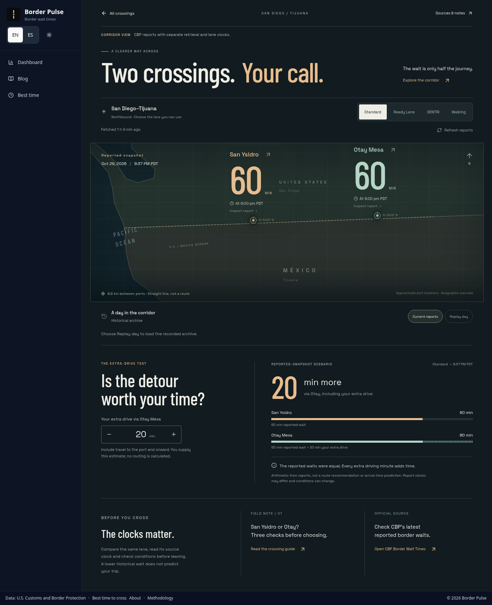
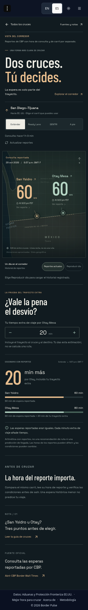
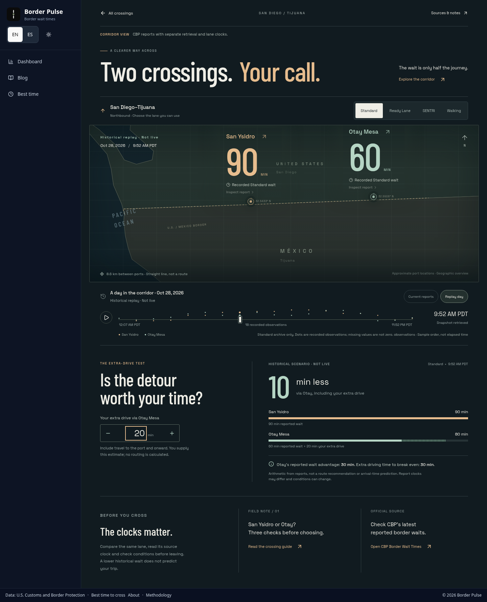
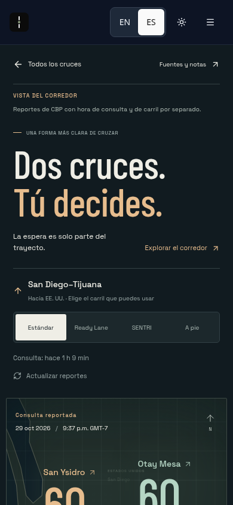
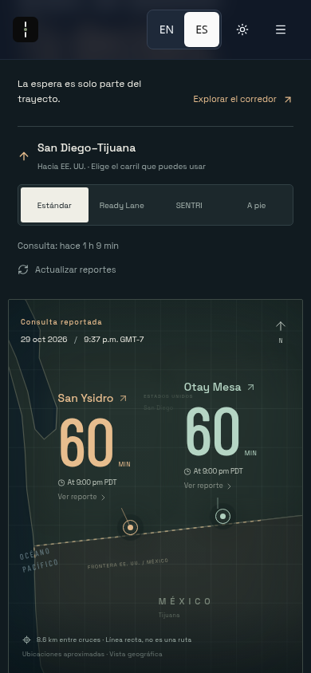
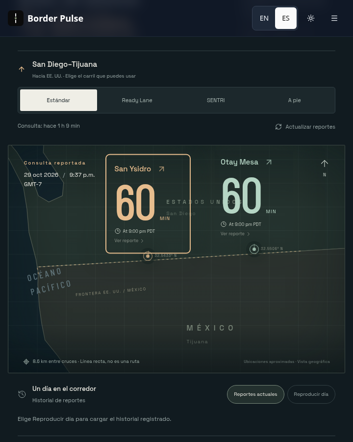
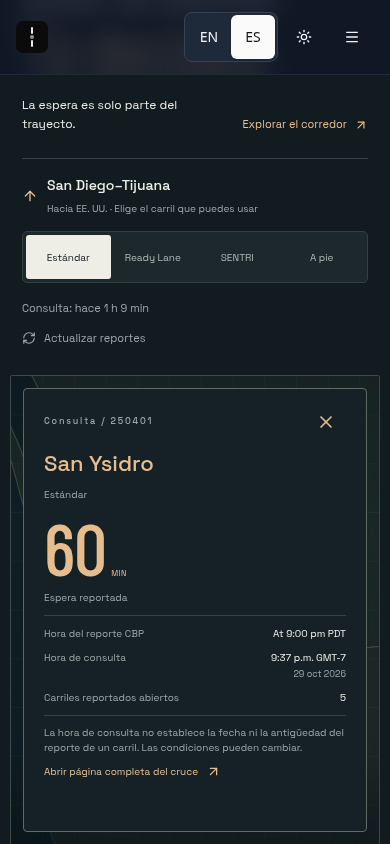

# San Diego–Tijuana corridor console

Review candidate at `/corridor/san-diego-tijuana/`. Enter from the existing dashboard after selecting San Diego–Tijuana. The dashboard, global navigation, favorites, existing comparisons, sharing, news freshness and editorial pipeline retain their current behavior. This candidate is not a production release or evidence that the owner has seen the design.

These are local browser captures of the integrated application using the dated published data bundled with base `19713e904f6ad0d41ae20f727b82790e8284edb3`. They are visual implementation evidence, not claims about present crossing conditions or production deployment. The screenshots use the existing dark-theme control.

### Responsive and motion review

The original mobile full-page capture included a sticky header at a scrolled capture position. It has been replaced with a capture taken at scroll position zero. The clean viewport captures below show normal use before and after scrolling; the header stays at the top of the viewport. Both port controls were hit-tested as unobscured in the scrolled map views. The top-of-page screenshot naturally has content continuing below the viewport.

[Watch the 12-second integrated motion recording](corridor-console-review/motion-review.mp4). It records lane selection, the port-to-detail transition, keyboard historical replay and extra-drive input in the local built application. These are actual rendered interaction frames at 10 fps, using dated published data; it is not a deployed-preview recording or a smoothness measurement. [Capture metadata](corridor-console-review/capture-receipt.json) records the source state, viewport and scroll positions.

## Behavior and boundaries

- Lazy route with scoped CSS and self-hosted licensed fonts. No new dependency or eager import of the console, archive or geographic assets.
- Current reports use the existing `subscribeToBorderData` service and its refresh/fallback lifecycle. The existing port-hours, lane availability, exact canonical port identity and snapshot-freshness rules are reused. A stale, future, missing, failed or bundled-fallback retrieval cannot produce a current detour comparison. Retained reports keep their original clocks.
- Standard, Ready, SENTRI and walking reports remain distinct and URL-backed. Missing lanes never borrow Standard or another facility. Walking reports disable vehicle detour arithmetic.
- CBP's raw lane report clock stays separate from snapshot retrieval. No report calendar date is inferred from clock-only text. No wait is described as live.
- Replay loads `/data/snapshot-history.json` only on request. It selects at most 18 actual timestamped retrievals from the latest past port-local day having at least two valid retrieval records. A recorded retrieval with both waits missing, or with neither port present, stays selectable with both waits unavailable and no arithmetic. A latest day containing only gaps remains that day; it does not silently fall back to an older day with waits. Malformed timestamps/crossing containers and future/current-day records are excluded. Larger days are sampled, so unsampled records (including gaps) may be omitted; every missing value in a selected record remains missing. The chart draws no connecting line or zero for it. Only Standard summary waits were retained by the archive; other lanes, report clocks, counts and operational state are explicitly unavailable. The initial selection is the first sampled observation with both waits, when present; all sampled gaps remain available to scrub.
- The calculator subtracts user-entered extra driving time from the reported wait difference. It calculates no route, arrival forecast, traffic simulation or confidence score. Both source clocks and the limits remain visible.
- Real geographic west/east relationship, coarse country/coast geometry and approximate port coordinates. Canvas geometry and port/wait anchors use the same coordinate projection and one viewport-derived compact-layout choice, including when the map is narrower than 700px inside a wider viewport. The straight-line distance is explicitly not a driving route. The ocean label is translated in Spanish.
- Shared-element node/details transition, lane indicator and comparison bars. The motion preference subscribes to OS changes while the page is open; spatial and bar-width movement is removed under reduced motion.
- Native sources modal, keyboard slider, Escape/return focus, Spanish copy, current-report links, guide links and a dated no-JavaScript report fallback. The new route is served directly on static hosts and has its own canonical; it is outside the sitemap in this first release.

## Verification

Ten focused model tests cover lane identity, closure/hour guards, retrieval integrity, detour arithmetic, archive day selection, malformed/missing observations, all-missing records/days, bounded sampling and the shared map projection. Browser regression coverage is part of the normal route suite and checks dashboard entry, lane URLs and Back/Forward, exact clocks, valid/invalid arithmetic, partial and fully missing replay gaps, walking, keyboard, reduced motion, Spanish, stale data and failed refresh. It observes an actual drawn canvas vertex and DOM port/wait anchors at 1440, 1024, 900, 820, 780, 748, 720, 701, 700, 699, 640, 390 and 320px, then resizes back to 720 and 900px. It also checks timestamp/control separation and hit-tests port controls after scrolling at 720 and 390px. Browser tests use explicitly synthetic fixtures; the screenshots and recording above do not use those fixtures.

The original candidate passed local build/full tests (406 browser navigations) and remote CI (426 navigations on its merge ref). The responsive/gap repair requires fresh aggregate checks at its new head; exact-head results and the protected preview are recorded in draft PR #162. The bundle gates remain unchanged at 62 KiB entry JS and 20 KiB entry CSS. No dependency or lockfile change is involved.

## Scoped security review

Reviewed the additive route, data model, scoped styles, copy, geometry, static fallback, dashboard link, routing changes and regression scripts, following their existing data-service, availability, URL and freshness dependencies. No reportable source-to-sink vulnerability was found in this review. There is no new server endpoint, credential, permission, persistent user-data write, third-party script, dynamic HTML evaluation or user-selected network destination. Source text is rendered through React; links use fixed paths or a strict 40-character commit hash allowlist. The history request is cancellable, times out and bounds retained processing/observations. All CSS selectors are scoped to the new page, and the font URLs are same-origin.

This is a manual scoped diff review, not an automated Codex Security service scan or SARIF receipt. The security skill's required shared preflight resource was unavailable through the provided skill interface, and no scan-start API is exposed in this host. No security configuration was changed to bypass that limitation.

## Provenance and remaining limits

- Geography: [Natural Earth via geo-countries](https://github.com/datasets/geo-countries), public-domain country geometry, clipped to the corridor. No road map or routing accuracy is claimed.
- Approximate coordinates: [San Ysidro](https://en.wikipedia.org/wiki/San_Ysidro_Port_of_Entry), [Otay Mesa](https://en.wikipedia.org/wiki/Otay_Mesa_Port_of_Entry).
- Typography: [Space Grotesk](https://github.com/google/fonts/tree/main/ofl/spacegrotesk) and [Barlow Condensed](https://github.com/google/fonts/tree/main/ofl/barlowcondensed); SIL licenses are retained beside the two font files in `src/assets/corridor/`.
- This first route covers only the San Ysidro/Otay pair. The historical archive is fetched on request and can be several megabytes before transfer compression. It is not a prediction or representative statistical study.
- Desktop/mobile Chromium and narrow layouts are checked. Safari, Firefox, physical devices and screen-reader validation are not claimed.
- Roll back by reverting the additive route commit. No migration, feed mutation, editorial change or production service configuration is involved.
