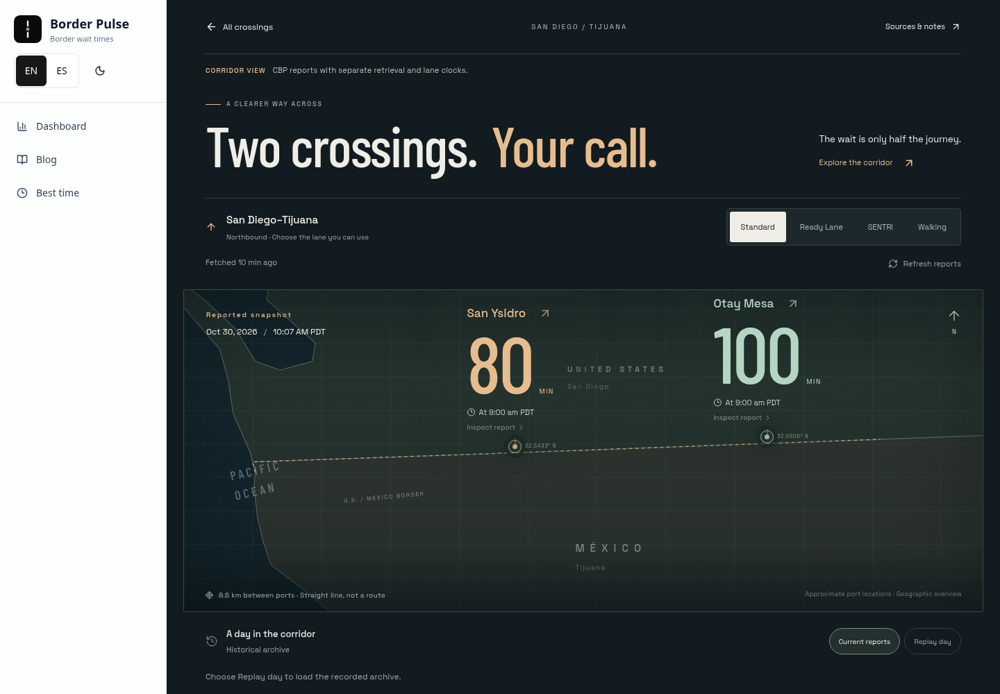
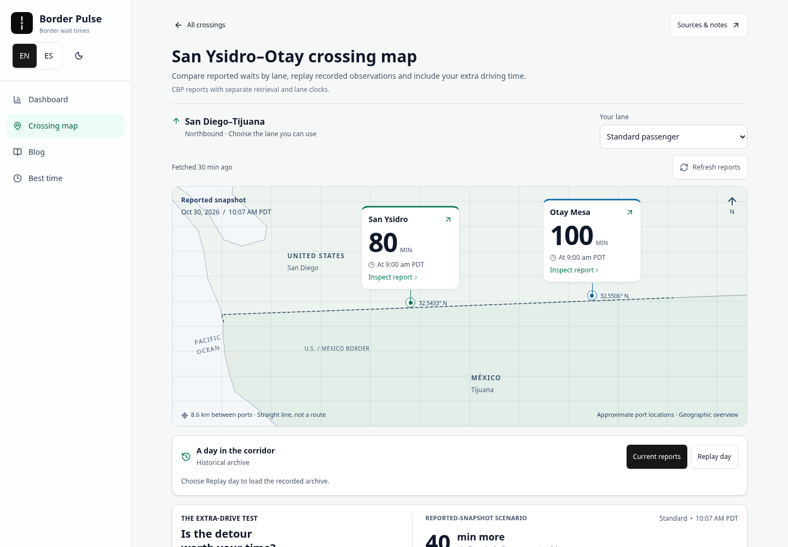
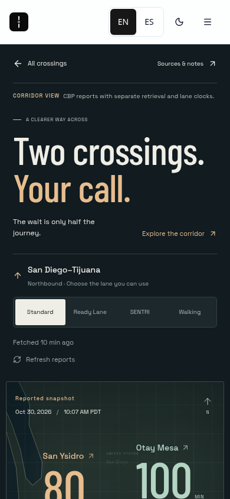
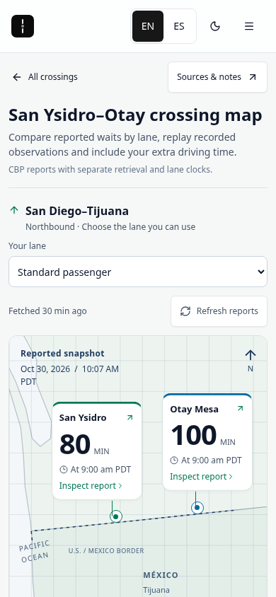
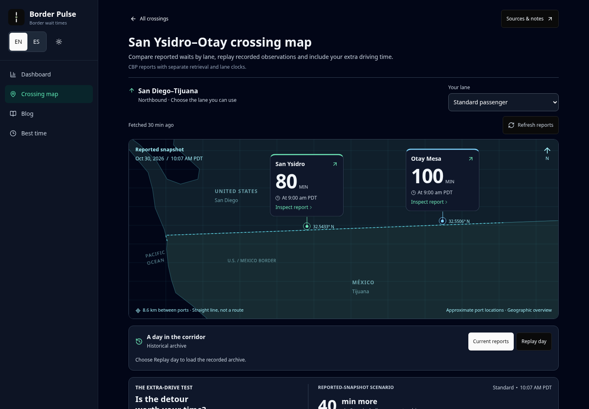
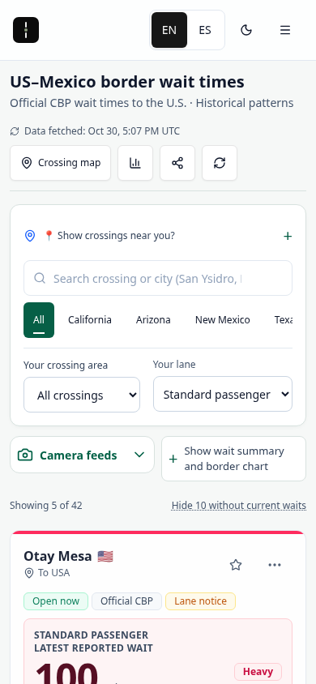
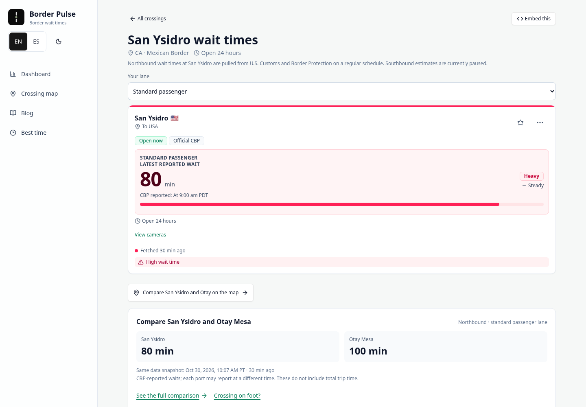
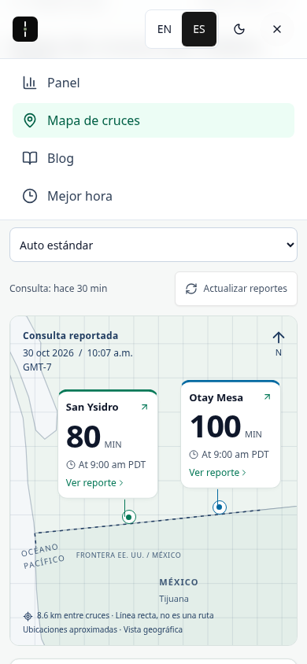
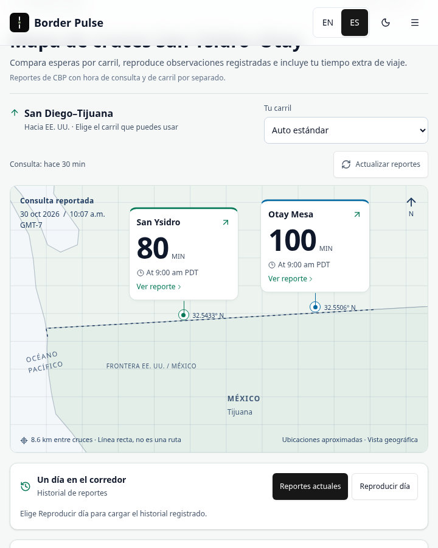

# Native BorderPulse crossing map

Review candidate for `/corridor/san-diego-tijuana/`, based on main `d8de71c`. This correction keeps the useful console interactions and makes their presentation and entry points consistent with the existing site. It is not a production-release receipt.

## Audit and visual target

The target is BorderPulse's existing dashboard, crossing page and blog: system type, slate text, emerald action links, the shared light/dark shell, compact headings, rounded report surfaces and existing controls. These are current-main renders captured before editing, using the actual dated published data in that checkout. The executor could not capture the public domain because its proxy returned `ERR_TUNNEL_CONNECTION_FAILED`; these images are not claimed as live-site captures.

1. **Dashboard — useful data, weak map entry.** The map link appeared only after choosing San Diego–Tijuana, beneath the local comparison. It was absent from the main navigation. [Reference dashboard](native-corridor-review/reference-dashboard.png).
2. **Crossing page — consistent native controls, missing map entry.** The report card, lane selector and comparison establish the style and primary task. [Reference crossing page](native-corridor-review/reference-crossing.png).
3. **Blog — consistent type and shell.** System headings, slate body text and emerald accents provide another existing brand reference. Editorial content is unchanged. [Reference blog](native-corridor-review/reference-blog.png).
4. **Console — visual mismatch confirmed.** It forced a separate dark palette in light mode, loaded display fonts and used a large promotional heading. On mobile, that heading delayed the actual port reports. The useful clock, lane, replay and detour behavior remains valuable.

| Before | After |
| --- | --- |
|  |  |
|  |  |

## Implementation

- Inherit the site's system type and light/dark presentation. Remove the console font-face declarations, fixed dark background, display headline and bespoke navigation strip. Existing font/license files remain untouched but are no longer requested by this route.
- Reuse `Layout`, `Button`, `Card`, `LaneSelector` and the existing `bp-line` blueprint map tokens. The canvas redraws when the shared theme changes. Existing slate/emerald report styles supply the surrounding surfaces and spacing.
- Add a named **Crossing map / Mapa de cruces** item to desktop/mobile navigation and a visible dashboard header action, including with no area selected. Keep the contextual area link, and add links after the primary reports on both San Ysidro and Otay pages. Header/crossing/navigation links preserve the selected lane; the mobile menu closes normally.
- Keep the shared port-to-detail transition and comparison feedback, using a short 180ms transition rather than the previous spring. Reduced motion still removes spatial/width movement, and waits/clocks update directly.
- Preserve the shared geographic projection, port identities, report/retrieval clocks, freshness guards, lane availability, actual-history gaps and user-supplied detour arithmetic. The data model, services, feeds, editorial pipeline and news logic are unchanged.
- Keep the dated no-JavaScript report fallback and canonical route; align its title/description with the native page heading.

## Evidence

All captures and the recording use actual dated published data, with source dates visible. No synthetic browser-test fixture, clock override, fabricated routing or traffic animation was used for these visuals. They are local implementation evidence, not current crossing conditions. [Capture metadata](native-corridor-review/capture-receipt.json).

[Dark mobile](native-corridor-review/after-mobile-dark.png) · [Report panel](native-corridor-review/detail-panel.png) · [Historical replay](native-corridor-review/replay.png) · [10-second rendered interaction recording](native-corridor-review/native-motion.mp4). The recording contains actual frames at 10fps; it demonstrates interaction transitions and is not a smoothness benchmark.

## Validation and limits

The production-mode local build and full test suite passed, including 406 browser navigations and the ten unchanged model tests. New browser assertions cover inherited typography, live light/dark canvas repainting, default-dashboard/nav/both-crossing discoverability and lane preservation. Existing coverage remains for 15 live map resizes per desktop/mobile journey, raw clocks, missing lanes, detour break-even/invalid input, partial/fully missing history records, Spanish, keyboard/focus, dynamic reduced motion, stale/future retrievals and failed refresh. The bundle gates are unchanged and pass at 61.67 / 62 KiB entry JS and 19.83 / 20 KiB entry CSS.

Local dependency audit returned zero high/critical and two moderate entries, with no dependency or lockfile changes. Manual scoped security review of the new navigation, markup, canvas theme observer and stylesheet found no reportable finding: fixed same-origin destinations, existing validated lane helpers, escaped React text, no new endpoint, credential, third-party request, storage write or analytics. Automated Codex Security service preflight remains unavailable in this executor; no automated-scan receipt is claimed.

Exact-head remote CI and protected-preview results belong in the draft PR. Browser plugin tools are unavailable here, so the existing Playwright/Chromium setup was used. Safari, Firefox, physical-device and screen-reader validation are not claimed. Direct public-site and protected-preview rendering are blocked by the executor's network proxy; independent visual review is still required before merge.
