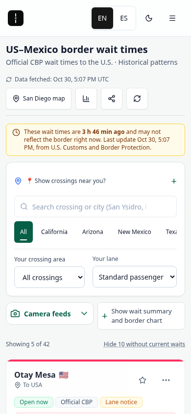
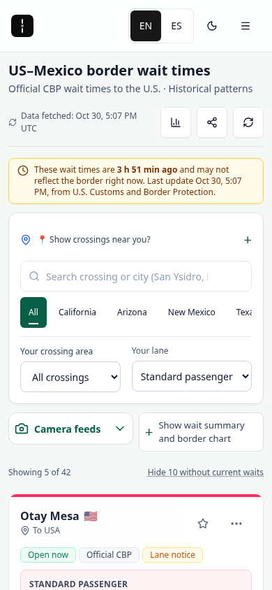
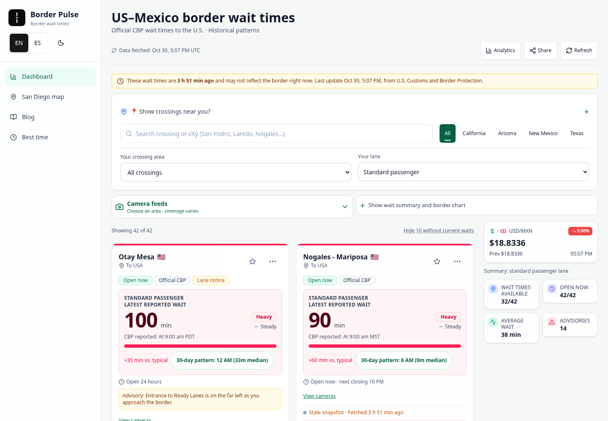
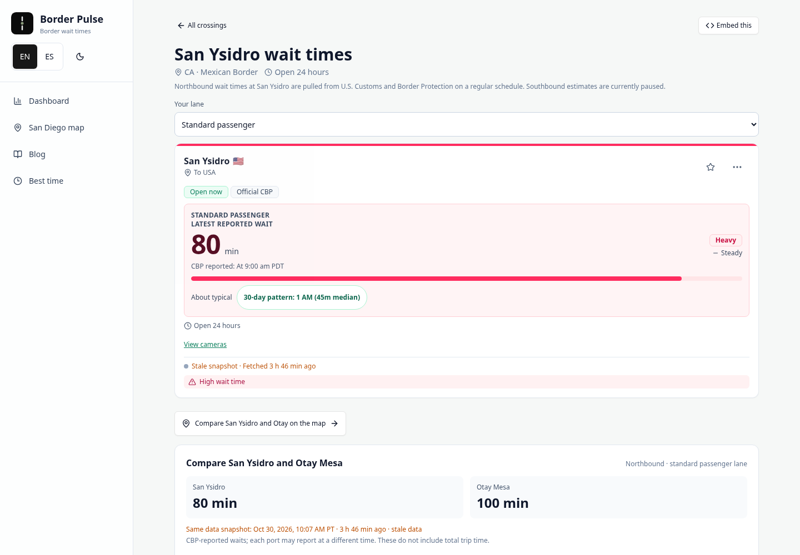
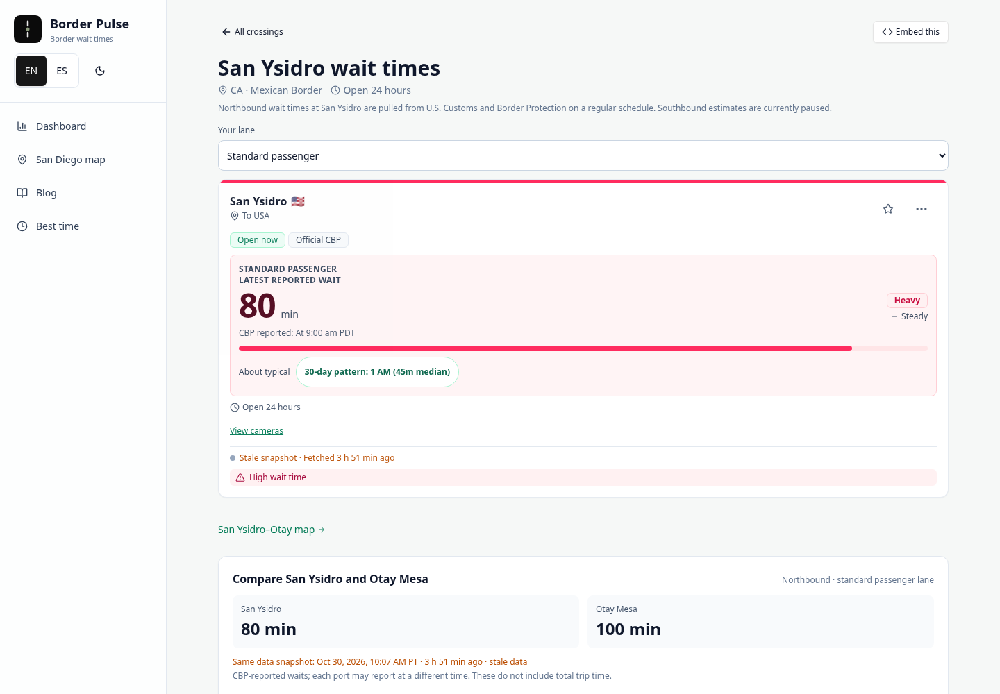

# Native BorderPulse crossing map

Review candidate for `/corridor/san-diego-tijuana/`, based on main `d8de71c`. This correction keeps the useful console interactions and makes their presentation and entry points consistent with the existing site. It is not a production-release receipt.

## Audit and visual target

The target is BorderPulse's existing dashboard, crossing page and blog: system type, slate text, emerald action links, the shared light/dark shell, compact headings, rounded report surfaces and existing controls. These are current-main renders captured before editing, using the actual dated published data in that checkout. The executor could not capture the public domain because its proxy returned `ERR_TUNNEL_CONNECTION_FAILED`; these images are not claimed as live-site captures.

1. **Dashboard — useful data, weak map entry.** The map link appeared only after choosing San Diego–Tijuana, beneath the local comparison. It was absent from the main navigation. [Reference dashboard](native-corridor-review/reference-dashboard.png).
2. **Crossing page — consistent native controls, missing map entry.** The report card, lane selector and comparison establish the style and primary task. [Reference crossing page](native-corridor-review/reference-crossing.png).
3. **Blog — consistent type and shell.** System headings, slate body text and emerald accents provide another existing brand reference. Editorial content is unchanged. [Reference blog](native-corridor-review/reference-blog.png).
4. **Console — visual mismatch confirmed.** It forced a separate dark palette in light mode, loaded display fonts and used a large promotional heading. On mobile, that heading delayed the actual port reports. The useful clock, lane, replay and detour behavior remains valuable.

| Before | After |
| --- | --- |
|  |  |
|  |  |

## Implementation

- Inherit the site's system type and light/dark presentation. Remove the console font-face declarations, fixed dark background, display headline and bespoke navigation strip. Existing font/license files remain untouched but are no longer requested by this route.
- Reuse `Layout`, `Button`, `Card`, `LaneSelector` and the existing `bp-line` blueprint map tokens. The canvas redraws when the shared theme changes. Existing slate/emerald report styles supply the surrounding surfaces and spacing.
- Keep one visibly regional **San Diego map / Mapa San Diego** item in desktop/mobile navigation. The page title identifies the actual San Ysidro–Otay pair; this does not suggest a map of all 42 crossings. After the user's screenshot review, remove the duplicated dashboard header/area promotions and restore the compact header flow. On San Ysidro and Otay pages, use a small native emerald text link after the primary report instead of an outlined button. Navigation/crossing links preserve the selected lane; the mobile menu closes normally and the contextual links retain a 44px touch target.
- Keep map report cards neutral. Colored markers and chart series identify the ports, with an explicit bilingual marker legend. They do not assign the green/blue port identity colors as congestion categories. Existing native crossing-report status classifications are unchanged; no new classification is introduced.
- Keep the shared port-to-detail transition and comparison feedback, using a short 180ms transition rather than the previous spring. Reduced motion still removes spatial/width movement, and waits/clocks update directly.
- Preserve the shared geographic projection, port identities, report/retrieval clocks, freshness guards, lane availability, actual-history gaps and user-supplied detour arithmetic. The data model, services, feeds, editorial pipeline and news logic are unchanged.
- Keep the dated no-JavaScript report fallback and canonical route; align its title/description with the native page heading.

## Evidence

All captures and the recording use actual dated published data, with source dates visible. No synthetic browser-test fixture, clock override, fabricated routing or traffic animation was used for these visuals. They are local implementation evidence, not current crossing conditions. [Capture metadata](native-corridor-review/capture-receipt.json).

The following entry-point captures preserve the original `a197e76` candidate; the lean-access follow-up below supersedes their placements.

[Dark mobile](native-corridor-review/after-mobile-dark.png) · [Report panel](native-corridor-review/detail-panel.png) · [Historical replay](native-corridor-review/replay.png) · [10-second rendered interaction recording](native-corridor-review/native-motion.mp4). The recording contains actual frames at 10fps; it demonstrates interaction transitions and is not a smoothness benchmark.

### Lean access after the user's screenshot review

The user asked for more refined access without UI bloat. This bounded follow-up keeps the regional main-navigation entry, removes dashboard map promotions and replaces the two contextual map buttons with ordinary site text links. No new feature, panel or persistent control is added. The coordinator's warning-separation correction is retained in the parent commit `d139ba6f25f26145fc182d1b6e3edbe2be88be60`.

| Before access refinement | After access refinement |
| --- | --- |
|  |  |
|  |  |
|  |  |

[Mobile crossing link after normal scrolling](native-corridor-review/lean-after-crossing-390.png) · [Spanish mobile navigation](native-corridor-review/lean-after-navigation-es-390.png) · [Spanish mobile crossing link](native-corridor-review/lean-after-crossing-es-390.png) · [Capture receipt](native-corridor-review/lean-capture-receipt.json). Before captures render `d139ba6`; after captures render the appended lean-access source. These are local production-mode renders using the same actual dated snapshot, without a synthetic fixture or clock override. They do not show live crossing conditions. The mobile crossing captures intentionally scroll to the contextual link.

## Validation and limits

### Theme-paint check follow-up

The independent coordinator's `a197e76` aggregate run passed 221 unit checks, audit/budgets and the canonical/alias routes, but both console journeys stopped at the light-theme return assertion. Their production-mode `402c879` focused run reproduced that timeout on macOS/Node 25. Those runs are not a green aggregate suite, and the later assertions were not independently reached. Earlier worker pass counts below describe that worker's Linux runs only.

The Codex worker measured the actual canvas at desktop/390px and DPR 1, 1.5 and 2. The old corner sample lies on a grid stroke: desktop light RGBA was `[225,234,232,255]` at DPR 1 and `[215,225,225,255]` at DPR 2, while the interior ocean/US/Mexico colors stayed at the expected palette. The local old check returned successfully in all six measured scenarios, so the precise trigger of the coordinator's macOS mismatch remains unconfirmed; initial paint/layout timing is a hypothesis, not an established product defect.

The bounded correction changes only the existing browser check and this note. It waits for font readiness and a painted backing buffer matching the actual CSS dimensions and capped DPR, then checks opaque 5×5 interior ocean/US/Mexico patches against the expected light or dark palette (one-channel tolerance of 1). An observed new canvas draw and the correct palette are required after **each** toggle; the initial light sample is also checked for readiness. Wait values remain `45,30` through light → dark → light. At desktop DPR 2, the measured CSS/buffer dimensions were `1050×438` / `2100×876`, with draw counts `2 → 3 → 4`; all three interior regions changed to the dark palette and returned to the light palette. The six width/DPR combinations passed. Two negative controls suppressed the real root-class repaint callback separately for dark and returning light: both checks rejected the unchanged canvas despite the changed HTML class. No production code, timeout increase or theme-verification skip is introduced. Original `a197e76`, `d139ba6` and `402c879` artifacts remain intact.

The worker's exact-head production-mode build/bundle and complete focused journeys are reported in the job outcome. All 12 warning text-flow cases, lean EN/ES navigation, lane preservation and the remaining console assertions stay enabled. The coordinator will independently rerun the returned head's focused and route checks; neither that result nor a new full-suite pass is claimed here. Unchanged unit checks are not repeated for this test-only delta.

### Retrieval-warning separation follow-up

The coordinator independently reproduced a rendered concatenation in the original `a197e76923ee36533d572713ef0ff343e48fefab` production-mode artifact: the retrieval age and fallback/stale/failed-refresh warning ran together. The Codex worker restored the original block display for the warning span, without changing strings, clocks, state guards or the native styling. A focused geometry assertion fails on the original stylesheet and checks that the actual warning begins below the last retrieval-age line, starts at the paragraph edge, remains visible with the age and fits the viewport. The existing affected desktop/390px journeys cover EN/ES stale and failed-refresh states, plus the successful static-fallback warning in production API mode. Follow-up build/bundle/journey results are reported against the new commit; the coordinator's independent full-suite run on `a197e76` is not claimed as validation of that later commit. The original artifact remains preserved by its immutable commit and existing captures.

For the appended access correction, the focused journeys enter through the regional navigation in both languages, verify that the dashboard has no duplicate map promotion, and follow both ports' native text links while preserving distinct lane selections. Rendered geometry checks keep those links after the primary report, touch sized, borderless and within the viewport. The same journeys retain all 12 visible warning text-flow checks at 1440px/390px and the existing console interactions. The worker's exact-head build, bundle and focused journey results are returned in the job outcome; no broad-suite, remote-CI or production claim is extended from the original artifact to this later head.

The initial native-brand candidate passed the production-mode local build and full test suite, including 406 browser navigations and the ten unchanged model tests. After the bounded regional-label/marker-clarity refinement, the production-mode build and both focused desktop/mobile browser journeys passed again. These now assert visible regional EN/ES entry labels and neutral card borders with a marker-identity legend, alongside inherited typography, live light/dark canvas repainting, default-dashboard/nav/both-crossing discoverability and lane preservation. The journeys also retain 15 live map resizes each, raw clocks, missing lanes, detour break-even/invalid input, partial/fully missing history records, Spanish, keyboard/focus, dynamic reduced motion, stale/future retrievals and failed refresh. The bundle gates are unchanged and pass at 61.67 / 62 KiB entry JS and 19.83 / 20 KiB entry CSS. The full aggregate suite has not been repeated for this copy/style-only refinement; exact-head remote CI remains pending PR authorization.

Local dependency audit returned zero high/critical and two moderate entries, with no dependency or lockfile changes. Manual scoped security review of the new navigation, markup, canvas theme observer and stylesheet found no reportable finding: fixed same-origin destinations, existing validated lane helpers, escaped React text, no new endpoint, credential, third-party request, storage write or analytics. Automated Codex Security service preflight remains unavailable in this executor; no automated-scan receipt is claimed.

Exact-head remote CI and protected-preview results belong in the draft PR. Browser plugin tools are unavailable here, so the existing Playwright/Chromium setup was used. Safari, Firefox, physical-device and screen-reader validation are not claimed. Direct public-site and protected-preview rendering are blocked by the executor's network proxy; independent visual review is still required before merge.
